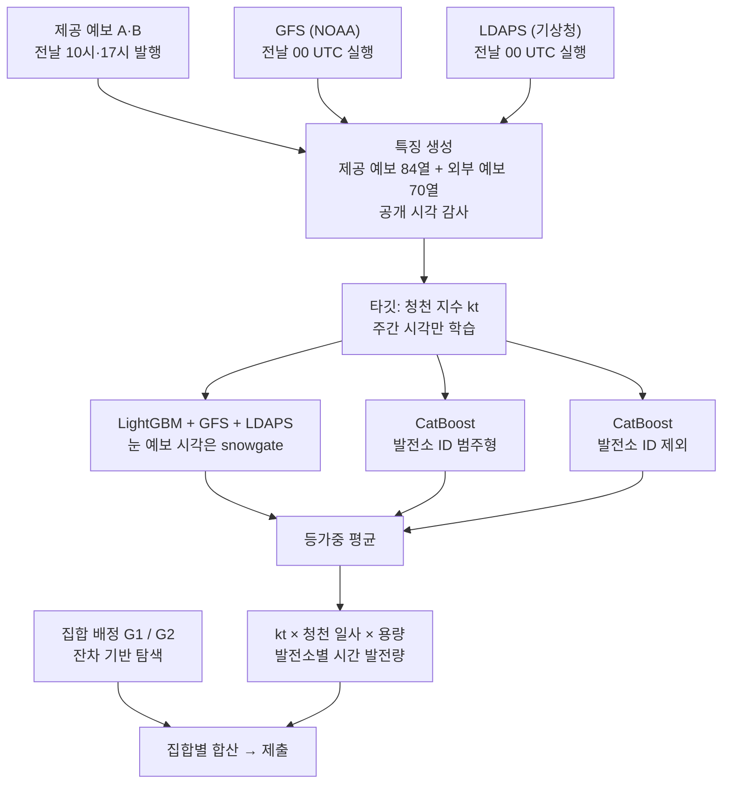
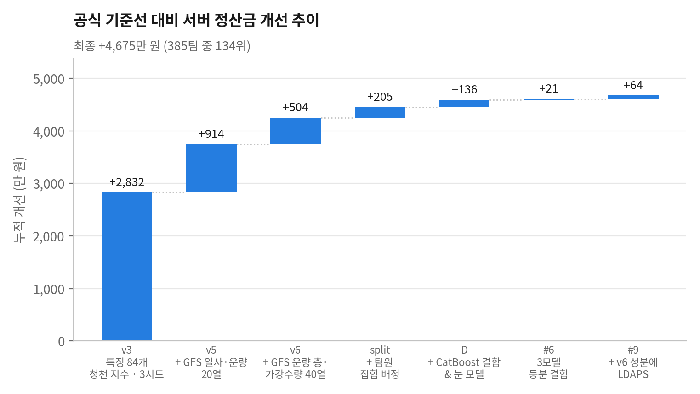
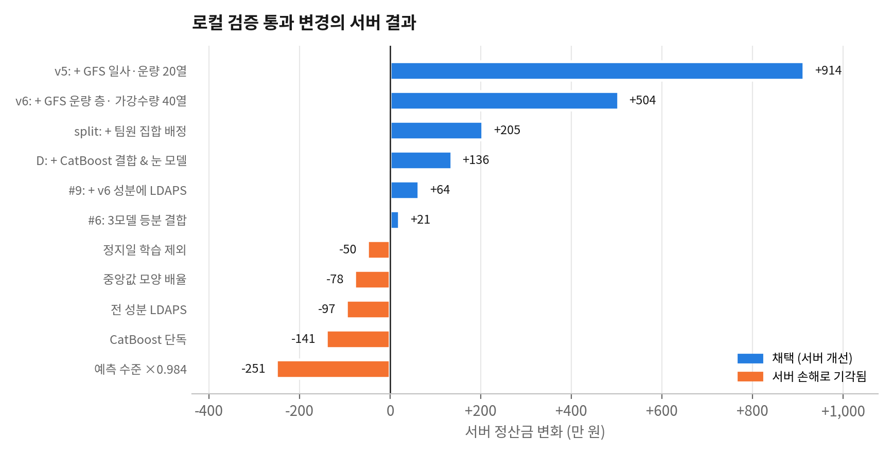
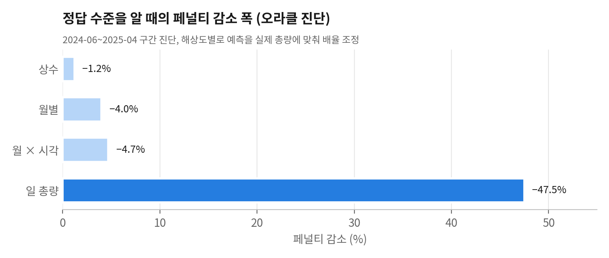

# 태양광 집합자원 구성 최적화 및 하루 전 발전량 예측 (OIBC 2026)

[English](README.md) · 한국어

> **요약**
>
> - 최종 134 / 385위(상위 35%), 정산금 6,465,154,213원. 공식 기준선 대비 +4,675만 원(페널티 25% 감소)
> - 서버에서 확인된 개선의 91%가 새 정보(제공 예보 특징 확장, 외부 수치예보 GFS·LDAPS)에서 비롯되었으며, 보정·튜닝·결합의 효과는 수십만 원 단위에 그침
> - 로컬에서 개선된 변경 다섯 건이 서버에서는 손해로 이어졌으며, 표본 밖 검증이 한 해에 집중되어 그해의 과대예측 편향이 판단에 반영되었음을 사후 분석으로 확인함([lessons.md](docs/lessons.md))

## 프로젝트 개요

<p align="center">
  
</p>

**2026 POSTECH OIBC Big Data Challenge**(제6회 POSTECH-UNIST-KAIST AI & 데이터사이언스 경진대회) 참가 프로젝트이다. 주제는 '집합자원 구성 최적화 및 하루 전 발전량 예측'이다.

- **과제**: 태양광 발전소 253개소(총 42.7 MW)를 두 집합(G1·G2, 각 20 MW 이상)으로 나누고, 집합별 시간 발전량을 대상일 전날 17시에 예측. 평가 기간은 2025-06 \~ 2026-05, 8,760시간
- **점수(정산금)**: `S = Σ SMP·실적 − 0.1 × Σ SMP·k·|예측 − 실적|`, 11\~15시는 k = 3. 절대오차를 **집합 단위**로 계산하므로 집합 내 발전소 오차는 서로 상쇄됨
- **핵심 관점**: 점수 개선은 둘째 항, 즉 SMP와 시간 가중을 곱한 집합 절대오차(페널티)를 줄이는 문제. 따라서 RMSE가 가장 낮은 모델이 반드시 최선의 제출은 아님
- **결과**: 최고 제출의 정산금 6,465,154,213원. 공식 기준선 대비 +4,675만 원, 정규화 점수 약 +25점(기준선 페널티 대비 25% 감소). 최종 순위 385팀 중 134위(2026-11-13 마감)
- **기간·환경**: 2026-10-01 \~ 11-13, 로컬 Mac(M2, 8 GB), 2인 팀

> 대회 규정에 따라 제공 데이터, 발전소 단위 예측, 제출 파일은 이 저장소에 포함하지 않았다. 문서의 수치는 모두 집계값이다.

## 데이터셋 및 탐색적 데이터 분석 (EDA)

| 자료 | 내용 | 규모 |
|---|---|---|
| 발전 실적 | 발전소별 시간 발전량(kWh), 2021-01 \~ 2025-05 | 약 439만 행 |
| 기상 예보 A·B | 두 제공사의 하루 전 예보(전날 10시·17시 발행), 관측지점 61·73개 | 470만·562만 행 |
| 실측 기상 | 학습 구간에만 존재하여 입력에서 제외 | — |
| SMP | 시간별 계통한계가격(학습·평가 구간) | 3.9만·8,760 행 |
| 발전소 메타 | 용량, 비식별 좌표(최대 2 km 이동), 연결 관측지점 | 253개소 |

**탐색 결과 및 설계 결정**

1. **발전량의 절반이 0**: 발전소 규모 차이도 큼(용량 중앙값 99 kW, 최대 약 1.4 MW) → 타깃을 kWh가 아닌 이용률(발전량 ÷ 용량)로 설정
2. **일사량 예보 미제공**: 운량과 자외선지수가 대리 변수이며, 두 제공사의 운량 상관은 0.73에 그침 → 외부 수치예보(GFS, LDAPS) 탐색의 계기
3. **발전소별 관측 시작 시점 상이**: 253개소가 모두 관측된 기간은 마지막 5개월뿐이며, 용량의 22%(48개소)는 2024-06 이후 편입 → 발전소별 모델 대신 전 발전소 공유 모델을 사용하고, 검증 구간도 이 제약에 맞춰 설계
4. **소수의 이상값**: 음수 40건, 채워 넣은 것으로 보이는 반복값 구간, 야간 발전 1건 → 원본은 수정하지 않고 학습 시에만 음수를 0으로 처리
5. **정합성 감사**: 예보 키 누락과 발행 시각, SMP 0원 시각, 평가 시간축을 점검. 17시 예보를 우선 사용하고 빈 곳을 10시 예보로 채우면(플래그 추가) 평가 구간 결측 0건
6. **작은 집합 구성 여지**: 예측을 고정하면 페널티는 `0.1·Σ w·|전체 오차 합|` 아래로 내려갈 수 없으며, 참조 배정은 이 하한보다 2.6%만 높음 → 구성보다 예측 개선에 집중하기로 결정

## 데이터 전처리 및 파생변수 생성

- **타깃**: 청천 지수 `kt = 이용률 ÷ Haurwitz 청천 일사(cosz)`, 0\~2로 절단. 학습 가중치는 `용량 × 청천 일사`. 주간(태양고도 > 0)만 학습하고 야간은 0으로 예측
- **학습 마감**: 각 검증 구간의 첫 대상일 전날 17:00까지의 자료만 사용. 제출용 모델은 2025-05-31 17:00까지 학습

**제공 예보 기반 84열**
- A·B 예보 전 열(17시 우선, 10시 대체 및 플래그), 10시와 17시 예보의 차이
- 운량·자외선지수의 앞뒤 1시간 값과 3시간 평균, 하루 평균·최대·합계
- 전 관측지점 평균(광역 날씨)과 예보 상관 기준으로 선정한 인접 관측지점 4곳 평균
- 태양 고도·방위·cos(천정각), 계절 sin/cos, 시각, 발전소 ID(범주형), 용량

**외부 수치예보 70열** (공개 시각이 예측 시점보다 이른 실행분만 사용)
- **GFS** (NOAA, 대상일 전날 00 UTC 실행): 하향 단파 일사, 전운량, 하·중·상층 운량, 가강수량 6개 변수 × 고정 2도 영역 10개 = 60열. 모든 발전소에 동일한 열 적용
- **LDAPS** (기상청 국지예보 1.5 km, 전날 00 UTC 실행): 하향 단파 일사 × 10개 영역 = 10열. 2026-03-31 생산 종료로 이후 기간은 결측
- 날짜별로 원격지 파일의 공개 시각을 감사하여, 예측 시점(전날 08:00 UTC) 이후 자료의 혼입을 방지

## 모델링 및 검증 전략

**파이프라인**



**모델**
- **주력**: LightGBM(600 트리, lr 0.06, 잎 127, min_child 200), L2 손실, 3시드 평균. 253개소 전체를 하나의 모델로 학습
- **최종 제출**: 이질적인 세 예측의 등가중 평균
  1. LightGBM + GFS + LDAPS. 눈 예보 시각은 팀원의 적설 전용 모델(snowgate)로 대체
  2. CatBoost(발전소 ID 범주형)
  3. 발전소 ID를 제외한 CatBoost
- **집합 배정**: 팀원이 학습 기간 잔차로 탐색한 배정을 사용. 서버에서 참조 배정 대비 +205만 원

**검증**
- 무작위 분할 없이 시간순 검증만 사용하며, 각 구간의 예측 시점 이전 자료로만 학습
- **계절 4구간**: 여름·가을·겨울·봄마다 별도의 학습 마감 설정
- **고정 11개월**: 2024-05 마감 모델 하나로 2024-06 \~ 2025-04를 예측하여 1년 단위 평가를 모사
- **지표**: 로컬 채점기(대회 산식 구현, 자체 검사 포함)로 산출한 집합 페널티. 7일 블록 부트스트랩으로 90% 구간을 함께 산출
- **사전 등록 규칙**: 실험마다 가설, 변경, 판정 기준을 결과 확인 전에 문서로 고정
  - 채택 기준: 4계절 합 ≤ −1%, 개선 계절 ≥ 3, 최악 계절 ≤ +3%, 고정 11개월 ≤ 0%
- **holdout**: 2025-05는 v3 선택 완료 후 처음 채점(+16.6점). 이후 GFS 후보(20열·60열)의 제출 전 확인에 한 번씩 추가 사용(p27). 후보 선택에는 사용하지 않았으나, 엄밀한 의미의 1회용 holdout은 아님
- **서버 제출**: 리더보드를 보고 배율이나 혼합을 조정하지 않음. 사전에 정한 후보만 1회씩 제출

자세한 내용은 [docs/validation.md](docs/validation.md)에 정리하였다.

## 실험 결과 및 성능 개선 과정

**서버 점수 추이** (정산금 S, 개선 폭은 직전 최고 대비)

| 단계 | 변경 | S (원) | 개선 |
|---|---|---:|---:|
| 공식 기준선 | 제공 `baseline.py` | 6,418,399,860 | — |
| v3 | 특징 84개, 2021년 이후 전체 이력, 청천 지수 타깃, 3시드 | 6,446,717,423 | +2,832만 |
| v5 | + GFS 일사·운량 20열 | 6,455,854,022 | +914만 |
| v6 | + GFS 운량 층·가강수량 40열 | 6,460,890,524 | +504만 |
| v6 + 배정 | 팀원 배정(nolimit) | 6,462,937,912 | +205만 |
| D | + CatBoost 결합, 눈 모델 | 6,464,297,778 | +136만 |
| 6번 | 3모델 등분 | 6,464,511,199 | +21만 |
| **9번** | **v6 성분에 LDAPS 추가** | **6,465,154,213** | **+64만** |

<p align="center">
  
</p>

**로컬 개선 및 서버 손해**: 아래 세 변경은 로컬 검증에서는 개선되었으나 서버에서는 손해로 이어졌다.
- CatBoost 단독
- 전 성분 LDAPS
- 예측 수준 하향(×0.984)

<p align="center">
  
</p>

위 차트에는 [docs/experiments.md](docs/experiments.md) 2절의 서버 손해 다섯 건을 모두 포함하였다.

**기각한 실험** (약 90개 중 대표)
- **대체 예보**: ECMWF, 일본 MSM, GEFS 평균·퍼짐·에어로졸, 기상청 단기예보, LDAPS 세밀 격자. 모두 하루 총량 설명력이 GFS보다 낮거나 같음
- **손실·가중**: L1, Huber, SMP·k 가중
- **사후 보정**: 기온·계절별 보정
- **구조**: 잔차 시퀀스 모델(TCN), 원천별 자매 모델
- **튜닝**: 하이퍼파라미터 탐색
- **기타**: 휴일 특징, 배정 재탐색

**오라클 기준 페널티 성분 분해** (진단용)
- 날마다 총량을 맞혔다면 페널티 47.5% 감소
- 월별 수준을 맞혔다면 페널티 4.0% 감소

<p align="center">
  
</p>

남은 오차의 절반은 '그날 얼마나 흐린가'를 예측하는 문제이다. 일사 예보의 질이 중요하지만, 그것만으로 결정되지는 않는다. 하루 안의 구조를 다루는 모델도 필요하다(회고 참고).

전체 목록은 [docs/experiments.md](docs/experiments.md)에 정리하였다.

## 폴더 구조

```
.
├── README.md / README.ko.md
├── LICENSE              # 코드: MIT. 대회 데이터는 포함하지 않음
├── requirements.txt
├── docs/
│   ├── problem.md        # 문제 정의 및 점수 구조 분석
│   ├── validation.md     # 검증 설계, 채택 기준, 한계
│   ├── experiments.md    # 실험 전체 목록: 가설 → 결과 → 판정
│   ├── lessons.md        # 로컬·서버 불일치 원인 분석 및 교훈
│   └── OIBC2026_technical_report.pdf   # 영문 기술 보고서 3쪽
├── scripts/
│   ├── check_publish.py  # 공개 전 점검(데이터·키·좌표·식별자)
│   ├── build_report.py   # 기술 보고서 PDF 생성(집계값만 사용)
│   └── make_readme_figures.py   # README 그림 생성(공개 집계값만 사용)
├── src/
│   ├── config.py, data.py, solar.py, splits.py   # 경로·로딩·태양 위치·검증 구간
│   ├── scoring.py, validate_submission.py        # 채점기(--selftest), 제출 형식 검사
│   ├── features.py, train.py                     # 특징 캐시, 학습·검증 공통 진입점
│   ├── gfs_fetch.py, gfs_more.py, ldaps_fetch.py # 외부 예보 수집(공개 시각 검사 포함)
│   ├── compose.py                                # 집합 배정 탐색
│   ├── make_submission.py, make_portfolio.py     # 최종 학습·조립·검증
│   ├── submission_log.py                         # 제출 기록 및 기대 점수
│   ├── snow_gate.py, snowgate_submission.py      # 적설 전용 모델 게이트(팀원)
│   ├── search_oof.py                             # OOF 잔차 기반 배정 탐색(팀원)
│   ├── <공용 모듈>.py                             # 위 진입점이 사용하는 특징·모델 보조 모듈
│   └── experiments/<실험명>.py                   # 실험·진단 스크립트(docs/experiments.md와 대응)
├── tests/                                        # 합성 입력 단위 테스트(python -m unittest discover -s tests -t .)
└── experiments/<실험명>/metrics.json             # 실험별 집계 지표
```

- `src/`에는 제출 파이프라인과 그 파이프라인이 import하는 모듈만 배치. 일부 공용 모듈(`gfs_pilot`, `tune_v3` 등)은 이름은 실험이지만, 최종 파이프라인이 내부 로더를 사용하므로 `src/`에 유지
- 실험 스크립트는 `python -m src.experiments.<이름>`으로 실행

## 실행 방법

대회 제공 데이터가 필요하며, 데이터는 저장소 밖에 둔다.

```bash
python3.9 -m venv .venv && .venv/bin/pip install -r requirements.txt
export OIBC_DATA_ROOT=/path/to/OIBC_2026_data      # raw/train, raw/test, raw/sites.csv, raw/smp.csv

.venv/bin/python -m src.scoring --selftest           # 채점기 자체 검사
.venv/bin/python -m src.features                     # 특징 캐시 생성
.venv/bin/python -m src.train d1_kt fold=development weight=cap train_start=2021-01-01 target=kt

# 외부 예보 (GFS는 공개 저장소, LDAPS는 기상청 API허브 인증키 필요)
.venv/bin/python -m src.gfs_fetch 2021-01-02 2026-05-31          # 일사·전운량 20열
.venv/bin/python -m src.gfs_fetch 2021-01-02 2026-05-31 more     # 운량 층·가강수량 40열
KMA_AUTH_KEY=... .venv/bin/python -m src.ldaps_fetch 2021-01-02 2026-03-31

# 최종 구성 요소 학습 및 제출 조립
.venv/bin/python -m src.make_portfolio train v6l
.venv/bin/python -m src.make_portfolio build 6
```

- 각 스크립트는 집계 지표만 출력하고 `experiments/<실험명>/metrics.json`에 저장
- 공개 전에는 `python scripts/check_publish.py` 실행

### 재현 범위

| 제출 | 재현 | 필요 항목 |
|---|---|---|
| v3, v5, v6 | 가능 | 대회 데이터, GFS(공개) |
| C (v6 + CatBoost 결합) | 가능 | 위 항목 + `make_submission ... blend_cb=1` |
| D, 4 \~ 7번 | 가능(해시 미확인) | 위 항목 + snowgate 예측(`scripts/snowgate_run.sh`) |
| **9번(최고 점수)** | 조건부 | 위 항목 + LDAPS(기상청 API허브 키), 조립 스크립트 없음(아래 식 참고) |

- **팀원 작성 코드**: snowgate(적설 전용 모델) 및 배정 탐색. `src/snow_gate.py`, `src/snowgate_submission.py`, `src/search_oof.py`, `src/experiments/eval_comp.py`, `src/experiments/eval_forecast.py`, `scripts/snowgate_run.sh`, `src/features.py`의 `snow` 묶음
- `scripts/snowgate_run.sh`는 v6 기본 예측, 눈 모델 예측(`feats=fullc+snow`), 게이트 결합을 순서대로 생성. 배정 파일 `composition_oof_gfs60_nolimit.csv`는 `src.search_oof`로 생성. 단, 당시 제출 묶음과의 해시 일치 여부는 공개 저장소 구조에서 재확인하지 않음
- `make_portfolio build`는 재생성한 snowgate 예측을 우선 사용하고, 없으면 당시 받은 묶음(`OIBC_SNOWGATE_ZIP`, 기본 `$OIBC_DATA_ROOT/external/`)을 읽음
- 9번은 조립 스크립트 없이 식만 기록됨. 9번 = 6번 + (1/3)·(v6l − v6)이며, snowgate 게이트 밖이면서 2026-03-31 이전인 행에만 적용. v6l은 `make_portfolio train v6l`로 생성하는 v6+LDAPS 3시드 예측
- LDAPS는 2026-03-31에 생산이 종료되어, 이후 기간은 GFS만으로 예측

## 회고

**잘한 점**
- **점수 구조 우선 분석**: 집합 절대오차의 하한을 수식으로 정리하여, 구성보다 예측에 투자할 근거를 초기에 확보
- **실험 사전 등록**: 약 90개 실험 모두 결과 확인 전에 기준을 고정. 리더보드에 맞추지 않았으므로 실제 개선 요인을 구분할 수 있음
- **외부 예보의 체계적 선별**: 예보 5종의 '하루 총량 설명력'을 학습 전에 비교하여, 수집 비용을 들이기 전에 선별. 가장 큰 개선(GFS +1,400만 원)이 이 과정에서 확보됨

**부족했던 점**
- **검증 연도의 편중**: 실질적인 표본 밖 검증이 2024-06 \~ 2025-04 한 해에 집중됨. 그해 모델은 실적보다 1.3% 과대예측하였고, 그 결과 '예측을 낮추는' 변경이 로컬에서 유리하게 나타남. 평가 연도는 반대 양상이었으며, 같은 원인으로 서버 손해가 세 차례 발생함([docs/lessons.md](docs/lessons.md))
- **하루 총량 오차 미해결**: 페널티의 절반이 하루 총량 오차이나, 시각별 트리 모델은 '흐린 날은 하루 종일 흐리다'는 구조를 직접 다루지 못함. 하루 단위 시퀀스 모델은 완성하지 못함
- **격차 원인을 예보 정보로만 해석**: 대회 종료 후 운영팀 공지에 따르면, 코드 검증을 마친 상위권 2팀은 외부 기상 3소스와 함께 ML·DL 혼합 앙상블을 사용함. 본 팀도 외부 예보를 같은 방식(공개 시각 감사)으로 사용하였으나, 모델은 트리 계열뿐이었음. 본 팀의 오차율은 약 3.6%로 추정되며, 수렴한 상위권(3.0 \~ 3.3%)보다 오차가 12 \~ 18% 큼([docs/lessons.md](docs/lessons.md))
- **배정 탐색의 단일 구간 검증**: 잔차 기반 배정이 다른 구간에서 재현되지 않아 참조 배정에 가깝게 유지됨. 상위 팀은 여러 학습 기간의 교차검증 오차로 탐색함. 배정 효과(1 \~ 2%)로 1위와의 격차를 설명할 수는 없음. 다만 밀집한 순위 구간에서는 수십 계단의 차이로 이어짐

**향후 개선 방향**
- 검증을 여러 연도 블록으로 분할
- 사후 보정은 '기준 예측의 수준을 바꿔도 효과가 유지되는가'를 확인한 뒤 채택
- 하루 단위 구조(일 총량 → 시간 배분)를 초기에 설계하고, 트리 모델과 이질적인 DL 계열을 앙상블 후보로 조기 도입
- 배정 탐색도 여러 기간의 표본 밖 오차로 검증

## 팀

- [@soonjae-dev](https://github.com/soonjae-dev): 문제 분석, 특징·학습 파이프라인, 검증 설계, 외부 예보 수집, 최종 결합
- [@Xterbase](https://github.com/Xterbase): 적설 전용 모델(snowgate), 집합 배정 탐색

## 라이선스

코드는 [MIT 라이선스](LICENSE)를 따른다. 대회 제공 데이터(발전 실적, 기상 예보, SMP, 발전소 정보)는 이 저장소에 포함하지 않았으며, 대회 규정상 재배포할 수 없다. 외부 예보(GFS, LDAPS 등)는 각 제공 기관의 이용 조건을 따른다.
