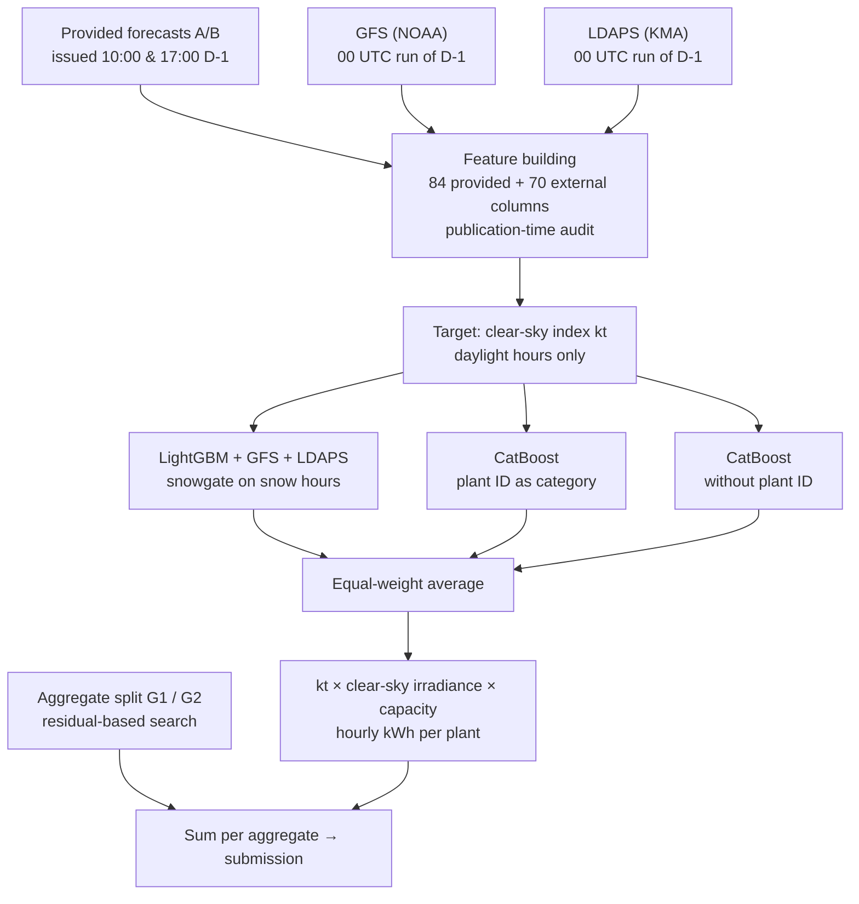
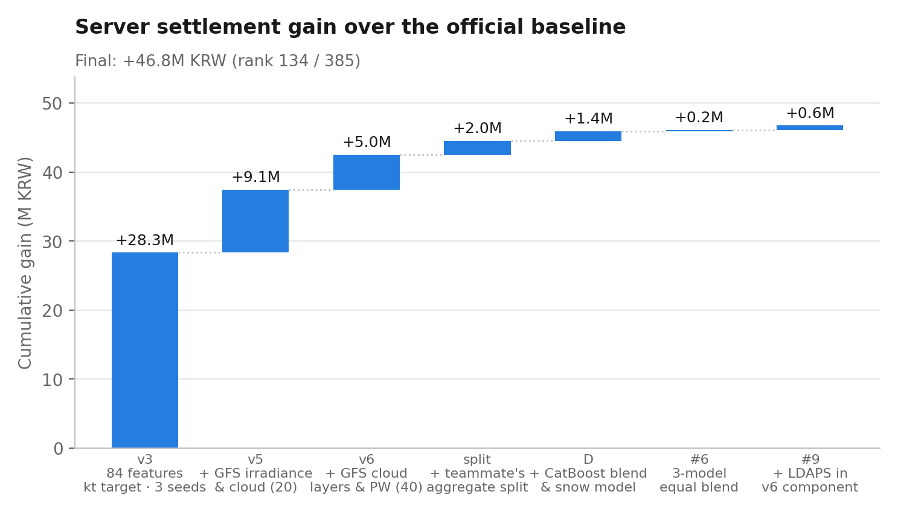
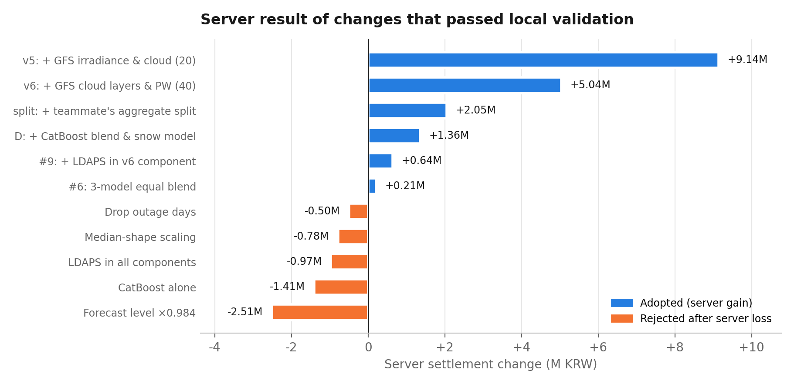
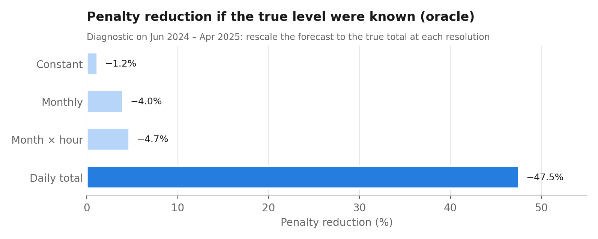

# Solar Aggregation & Day-Ahead PV Forecasting (OIBC 2026)

English · [한국어](README.ko.md)

> **Summary**
>
> - Final rank 134 / 385 (top 35%), settlement 6,465,154,213 KRW: +46.8 M KRW over the official baseline (25% lower penalty)
> - 91% of the server-confirmed gain came from new information (richer features from the provided forecasts, external NWP from GFS and LDAPS). Calibration, tuning and blending were worth only hundreds of thousands of KRW
> - Five changes that helped locally hurt on the server. Out-of-sample validation was concentrated in one year, and that year's over-forecast bias leaked into every decision ([lessons.md](docs/lessons.md))

## Project Overview

<p align="center">
  
</p>

This is our entry to the **2026 POSTECH OIBC Big Data Challenge** (6th POSTECH-UNIST-KAIST AI & Data Science Competition). The theme is *aggregated resource composition and day-ahead PV generation forecasting*.

- **Task.** Split 253 PV plants (42.7 MW in total) into two aggregates (G1/G2, each ≥ 20 MW). For each aggregate, forecast hourly generation at 17:00 KST on the day before delivery. The evaluation period is June 2025 – May 2026 (8,760 hours).
- **Score (settlement).** `S = Σ SMP·actual − 0.1 × Σ SMP·k·|forecast − actual|`, with k = 3 for 11:00–15:00. The absolute error is taken **per aggregate**, so errors of plants inside the same aggregate cancel.
- **Key framing.** Improving S means reducing the second term: an SMP- and hour-weighted absolute error on aggregate sums (the *penalty*). The model with the lowest RMSE is therefore not necessarily the best submission.
- **Result.** Best submission S = 6,465,154,213 KRW. That is +46.8 M KRW over the official baseline, or about +25 normalized points (a 25% penalty reduction vs. the baseline). Final leaderboard rank: 134th of 385 teams (competition closed 2026-11-13).
- **Setup.** Oct 1 – Nov 13, 2026, on a local MacBook (M2, 8 GB). Team of two.

> Under the competition rules, the provided data, plant-level predictions and submission files are **not** included in this repository. All numbers in the docs are aggregates.

## Dataset & Exploratory Data Analysis (EDA)

| Source | Content | Size |
|---|---|---|
| Generation | Hourly kWh per plant, 2021-01 – 2025-05 | ~4.39 M rows |
| Weather forecasts A/B | Day-ahead forecasts from two vendors, issued at 10:00 and 17:00 the day before; 61/73 stations | 4.7 M / 5.6 M rows |
| Observed weather | Training period only; excluded as input because it is absent at test time | — |
| SMP | Hourly system marginal price | 39 k / 8,760 rows |
| Plant metadata | Capacity, de-identified coordinates (shifted ≤ 2 km), linked stations | 253 plants |

**Findings and the design decisions they drove**

1. **Half of all hours are zero, and plant sizes vary widely** (median 99 kW, max ≈ 1.4 MW). → We model the capacity factor, not raw kWh.
2. **No irradiance forecast is provided.** Cloud cover and UV index are proxies, and the two vendors' cloud forecasts correlate at only 0.73. → This motivated our search for external NWP data (GFS, LDAPS).
3. **Plants come online at different times.** All 253 plants are observed together only in the last 5 months, and 22% of capacity (48 plants) joined after June 2024. → We use one shared model for all plants rather than per-plant models, and the validation folds follow this constraint.
4. **Anomalies are rare:** 40 negative values, a stretch of apparently filled values, and one night-time reading. → Raw data is left untouched; negatives are clipped to 0 for training only.
5. **Integrity audit.** We checked missing forecast keys, issue times, zero-SMP hours and the test time axis. Using the 17:00 forecast with the 10:00 one as fallback (plus a flag) leaves no missing test features.
6. **Composition has little headroom.** With forecasts fixed, the penalty cannot fall below `0.1·Σ w·|total error|`, and the reference split was only 2.6% above that bound. → We invested in forecasting first.

## Data Preprocessing & Feature Engineering

- **Target.** Clear-sky index `kt = capacity factor ÷ Haurwitz clear-sky irradiance(cos z)`, clipped to [0, 2]. Sample weight = capacity × clear-sky irradiance. We train on daylight hours only and predict 0 at night.
- **Training cutoff.** Only data available at 17:00 on the day before each fold's first target day. The final model is trained up to 2025-05-31 17:00.

**84 features from the provided forecasts**
- All A/B forecast fields (17:00 issue, 10:00 fallback with a flag), plus the 10:00-vs-17:00 revisions
- ±1 h lags, 3 h means and daily mean/max/sum of cloud cover and UV index
- An all-station mean (synoptic signal) and a 4-neighbour mean, with neighbours chosen by forecast correlation
- Sun elevation/azimuth/cos z, seasonal sin/cos, hour, plant ID (categorical), capacity

**70 external NWP features** (only runs published before the forecast deadline)
- **GFS** (NOAA, 00 UTC run of D-1): downward shortwave, total/low/mid/high cloud and precipitable water. 6 variables × 10 fixed 2° regions = 60 columns, identical for all plants.
- **LDAPS** (KMA 1.5 km local model, 00 UTC run of D-1): downward shortwave × 10 regions = 10 columns. Production ended on 2026-03-31, so later hours are missing.
- For every date, the publication time of the remote file was audited against the deadline (08:00 UTC on D-1).

## Modeling & Validation Strategy

**Pipeline**



**Models**
- **Core model:** LightGBM (600 trees, lr 0.06, 127 leaves, min_child 200), L2 loss, averaged over 3 seeds. One model covers all 253 plants.
- **Final submission:** an equal-weight average of three different predictors:
  1. LightGBM + GFS + LDAPS, with snow-forecast hours replaced by my teammate's snow-specific model (*snowgate*)
  2. CatBoost with plant ID as a categorical feature
  3. CatBoost without plant ID
- **Composition:** a split my teammate searched on training-period residuals (+2.05 M KRW vs. the reference split on the server).

**Validation**
- Strictly time-ordered. No random splits, and each fold uses only data available at its forecast time.
- **Four seasonal folds:** summer, autumn, winter and spring, each with its own training cutoff.
- **Static 11-month fold:** a single model trained up to May 2024 predicts June 2024 – April 2025, mimicking the one-year evaluation.
- The metric is the aggregate penalty from our local scorer, which implements the official formula and has self-tests. We report 7-day block-bootstrap 90% intervals.
- **Pre-registration:** for each experiment, the hypothesis, the change and the acceptance rule were written down before seeing results.
  - Acceptance rule: 4-season sum ≤ −1%, ≥ 3 seasons improved, worst season ≤ +3%, static fold ≤ 0%
- **Holdout:** May 2025 was first scored after v3 was selected (+16.6 points). It was then used once more each to confirm the GFS candidates (20 and 60 columns) before submission (p27). It never drove a selection, but it is not a strict single-use holdout.
- **Server submissions:** never tuned to the leaderboard. Each submission was a candidate fixed in advance, submitted once.

Details are in [docs/validation.md](docs/validation.md).

## Results & Improvement Process

**Server score progression** (settlement S; gain over the previous best)

| Step | Change | S (KRW) | Gain |
|---|---|---:|---:|
| Official baseline | Provided `baseline.py` | 6,418,399,860 | — |
| v3 | 84 features, full 2021+ history, clear-sky-index target, 3 seeds | 6,446,717,423 | +28.3 M |
| v5 | + GFS irradiance & cloud (20 cols) | 6,455,854,022 | +9.1 M |
| v6 | + GFS cloud layers & precipitable water (40 cols) | 6,460,890,524 | +5.0 M |
| v6 + split | Teammate's composition | 6,462,937,912 | +2.0 M |
| D | + CatBoost blend, snow model | 6,464,297,778 | +1.4 M |
| #6 | Equal blend of 3 models | 6,464,511,199 | +0.2 M |
| **#9** | **+ LDAPS in the LightGBM component** | **6,465,154,213** | **+0.6 M** |

<p align="center">
  
</p>

**Better locally, worse on the server.** These three changes improved local validation but lost points on the server:
- CatBoost alone
- LDAPS added to every component
- A lower forecast level (×0.984)

<p align="center">
  
</p>

The chart above covers all five server losses listed in section 2 of [docs/experiments.md](docs/experiments.md).

**Rejected experiments** (representative, out of ~90)
- Alternative forecasts: ECMWF, JMA MSM, GEFS mean/spread/aerosol, KMA short-range forecast, finer LDAPS grids. None explained daily totals better than GFS.
- Losses and weights: L1, Huber, SMP·k weighting
- Post-hoc corrections: temperature- and season-based
- Architectures: a residual sequence model (TCN), per-source sister models
- Tuning: hyper-parameter search
- Other: holiday features, a new composition search

**Penalty decomposition with oracle information** (diagnostic only)
- Matching each day's total would cut the penalty by 47.5%.
- Matching monthly levels would cut it by 4.0%.

<p align="center">
  
</p>

→ Half of the remaining error is *how cloudy tomorrow will be*. Irradiance forecast quality matters, but it is not the only limit: a model that captures within-day structure also matters (see Retrospective).

The full list is in [docs/experiments.md](docs/experiments.md).

## Folder Structure

```
.
├── README.md / README.ko.md
├── LICENSE              # code: MIT. Competition data not included
├── requirements.txt
├── docs/
│   ├── problem.md        # problem definition & score-structure analysis
│   ├── validation.md     # validation design, acceptance rules, limitations
│   ├── experiments.md    # all experiments: hypothesis → result → verdict
│   ├── lessons.md        # why local and server results diverged
│   └── OIBC2026_technical_report.pdf   # 3-page technical report
├── scripts/
│   ├── check_publish.py  # pre-publication check (data, keys, coordinates, IDs)
│   ├── build_report.py   # builds the report PDF from aggregates
│   └── make_readme_figures.py   # builds the README charts from published aggregates
├── src/
│   ├── config.py, data.py, solar.py, splits.py   # paths, loading, solar geometry, folds
│   ├── scoring.py, validate_submission.py        # scorer (--selftest), submission format check
│   ├── features.py, train.py                     # feature cache, common train/validate entry point
│   ├── gfs_fetch.py, gfs_more.py, ldaps_fetch.py # external NWP download (with publication-time checks)
│   ├── compose.py                                # composition search
│   ├── make_submission.py, make_portfolio.py     # final training, assembly, validation
│   ├── submission_log.py                         # submission ledger & expected scores
│   ├── snow_gate.py, snowgate_submission.py      # snow-model gate (teammate)
│   ├── search_oof.py                             # OOF-residual composition search (teammate)
│   ├── <shared module>.py                        # feature/model helpers used by the entry points above
│   └── experiments/<experiment>.py               # experiment & diagnostic scripts (see docs/experiments.md)
├── tests/                                        # unit tests on synthetic inputs (python -m unittest discover -s tests -t .)
└── experiments/<experiment>/metrics.json         # aggregate metrics per experiment
```

- `src/` holds the submission pipeline and the modules it imports. A few shared modules (`gfs_pilot`, `tune_v3`, etc.) keep experiment-like names but stay in `src/` because the final pipeline uses loaders defined in them.
- Run experiment scripts with `python -m src.experiments.<name>`.

## How to Run

The competition data is required and is kept outside the repository.

```bash
python3.9 -m venv .venv && .venv/bin/pip install -r requirements.txt
export OIBC_DATA_ROOT=/path/to/OIBC_2026_data      # raw/train, raw/test, raw/sites.csv, raw/smp.csv

.venv/bin/python -m src.scoring --selftest           # scorer self-test
.venv/bin/python -m src.features                     # build feature cache
.venv/bin/python -m src.train d1_kt fold=development weight=cap train_start=2021-01-01 target=kt

# External NWP (GFS is public; LDAPS needs a KMA API Hub key)
.venv/bin/python -m src.gfs_fetch 2021-01-02 2026-05-31          # irradiance & total cloud (20 cols)
.venv/bin/python -m src.gfs_fetch 2021-01-02 2026-05-31 more     # cloud layers & precipitable water (40 cols)
KMA_AUTH_KEY=... .venv/bin/python -m src.ldaps_fetch 2021-01-02 2026-03-31

# Final components and submission assembly
.venv/bin/python -m src.make_portfolio train v6l
.venv/bin/python -m src.make_portfolio build 6
```

- Every script prints aggregate metrics only and writes them to `experiments/<name>/metrics.json`.
- Run `python scripts/check_publish.py` before publishing.

### Reproducibility Scope

| Submission | Reproducible | Requires |
|---|---|---|
| v3, v5, v6 | Yes | Competition data, GFS (public) |
| C (v6 + CatBoost blend) | Yes | Above + `make_submission ... blend_cb=1` |
| D, #4 – #7 | Yes (hash not re-checked) | Above + snowgate forecast (`scripts/snowgate_run.sh`) |
| **#9 (best score)** | Conditional | Above + LDAPS (KMA API Hub key). No assembly script (formula below) |

- The snow-specific model (*snowgate*) and the composition search were built by a teammate. Code: `src/snow_gate.py`, `src/snowgate_submission.py`, `src/search_oof.py`, `src/experiments/eval_comp.py`, `src/experiments/eval_forecast.py`, `scripts/snowgate_run.sh`, and the `snow` group in `src/features.py`.
- `scripts/snowgate_run.sh` builds the v6 base forecast, the snow-model forecast (`feats=fullc+snow`) and the gated blend in turn. The composition file `composition_oof_gfs60_nolimit.csv` comes from `src.search_oof`. Hash equality with the original submission bundle has not been re-checked in this repository layout.
- `make_portfolio build` uses the regenerated snowgate forecast first and falls back to the original bundle (`OIBC_SNOWGATE_ZIP`, default `$OIBC_DATA_ROOT/external/`).
- #9 has no assembly script; only its formula is recorded: #9 = #6 + (1/3)·(v6l − v6), applied only to rows outside the snowgate gate and before 2026-03-31. Here v6l is the 3-seed v6+LDAPS forecast built with `make_portfolio train v6l`.
- LDAPS production ended on 2026-03-31, so later hours are forecast with GFS only.

## Retrospective

**What went well**
- **We analysed the score structure first.** Deriving the lower bound of the aggregate absolute error showed early that forecasting, not composition, was where to invest.
- **Every experiment was pre-registered.** For all ~90 experiments the acceptance rule was fixed before the results. Because nothing was tuned to the leaderboard, we can say which improvements were real.
- **External forecasts were screened systematically.** Five NWP sources were compared on how well they explain daily totals before any costly download or training. The largest gain (GFS, +14 M KRW) came from this.

**What fell short**
- **Validation was concentrated in one year.** Most out-of-sample evidence came from June 2024 – April 2025, when the model over-forecast by 1.3%. In that year, any change that lowered forecasts looked good locally. The evaluation year behaved the opposite way, and the same cause produced three server losses ([docs/lessons.md](docs/lessons.md)).
- **Daily-total error was never cracked.** Half of the penalty is daily-total error, but an hour-by-hour tree model cannot directly represent "a cloudy day is cloudy all day". We never fully built a day-level sequence model.
- **We attributed the gap to forecast information alone.** A post-competition notice from the organisers shows that the two top teams whose code was verified used three external weather sources *and* an ensemble mixing ML and DL models. We used external forecasts the same way (with publication-time audits), but only tree models. Our error rate is estimated at about 3.6%, which is 12–18% higher than the converged top group (3.0–3.3%) ([docs/lessons.md](docs/lessons.md)).
- **Composition search was validated on one window only.** Our residual-based assignments did not transfer to other windows, so we stayed close to the reference assignment. A top team searched with cross-validated errors from several training periods. Composition (1–2%) cannot explain the gap to first place, but in a dense leaderboard it is worth dozens of ranks.

**What we would do differently**
- Validate across several yearly blocks.
- Accept a post-hoc correction only if its gain survives shifts in the base forecast level.
- Design for day-level structure (daily total → hourly profile) from the start, and add DL models that differ from trees to the ensemble early.
- Validate composition search on out-of-sample errors from several periods.

## Team

- [@soonjae-dev](https://github.com/soonjae-dev): problem analysis, feature & training pipeline, validation design, external NWP collection, final blend
- [@Xterbase](https://github.com/Xterbase): snow-specific model (snowgate), group composition search

## License

The code is released under the [MIT License](LICENSE). The competition data (generation records, weather forecasts, SMP, plant metadata) is not included and may not be redistributed under the competition rules. External forecasts (GFS, LDAPS, etc.) are subject to their providers' terms.
